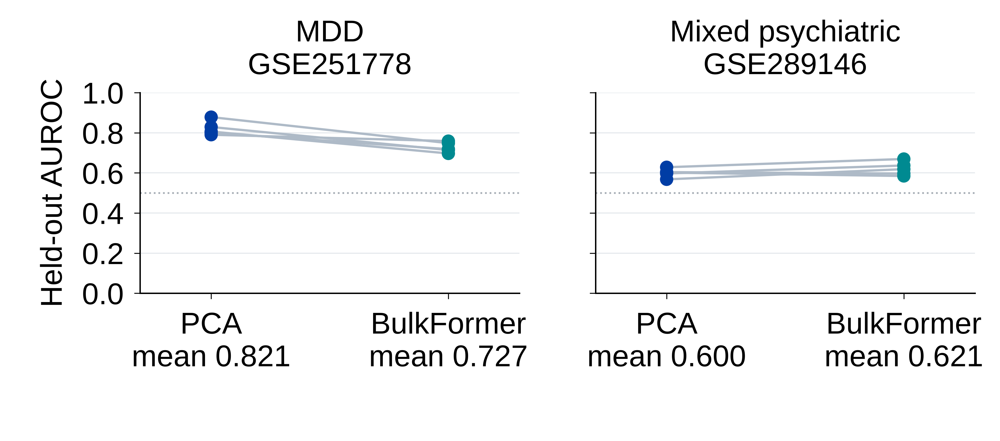

# Do Transcriptomic Foundation Models Beat PCA?
### Benchmarking BulkFormer for Blood-Based Classification of Depression

**Michigan AI Symposium · October 20, 2026 · Poster 72**

Bushra Rashrash¹, Tejaswi Manchineella², Meiling Zhou³, Kevin A. Maupin¹  
¹ Department of Information Sciences and Technologies · ² Department of Computer Science · ³ Department of Statistics  
Grand Valley State University, Michigan, USA

[Download the poster](poster/Rashrash_Michigan_AI_Symposium_2026_Poster.pdf) · [Analysis notebook](notebooks/01_bulkformer_pca_analysis.ipynb) · [Figure notebook](notebooks/02_poster_figures.ipynb) · [Results](results/) · [References](references.md)

## Research question

Do frozen BulkFormer-37M representations improve blood-based psychiatric classification beyond PCA? We compare both representations using the same ridge logistic regression, participants, and nested cross-validation folds in two public cohorts.

## Findings

| Cohort | Participants | PCA | BulkFormer-37M |
|---|---|---:|---:|
| GSE251778: peripheral blood leukocytes | 80 MDD, 89 controls | 0.821 | 0.727 |
| GSE289146: PBMCs, broader psychiatric phenotype | 229 affected, 70 controls | 0.600 | 0.621 |

Values are mean pooled out-of-fold AUROC across five CV repeats. **BulkFormer-37M did not consistently outperform PCA.** PCA had higher AUROC in every MDD repeat. In the mixed cohort, BulkFormer had higher mean pooled AUROC, while PCA had higher mean fold AUROC.

Adding age, BMI and sex increased PCA's mean pooled AUROC in MDD to 0.843. In the mixed cohort, covariates alone achieved 0.668, compared with approximately 0.651 for either representation combined with covariates. These are internal validation results, not clinical diagnostic performance estimates. The mixed cohort is exploratory, not an MDD replication or external validation.

## Figures

| Figure | Image | Vector PDF |
|---|---|---|
| Repeated CV | [PNG](figures/paired_repeats.png) | [PDF](figures/paired_repeats.pdf) |
| Feature and covariate sensitivity | [PNG](figures/sensitivity_combined.png) | [PDF](figures/sensitivity_combined.pdf) |
| Original paired AUROC differences | [PNG](figures/original_paired_difference.png) | [PDF](figures/original_paired_difference.pdf) |
| Exploratory separate-sex models | [PNG](figures/separate_sex_intervals.png) | [PDF](figures/separate_sex_intervals.pdf) |

The poster download is the supplied 11 × 8.5-inch viewing PDF. A separate [40 × 30-inch export](poster/Rashrash_Poster_40x30_Export.pdf) is also included. See [figure reproduction](docs/figure_reproduction.md) for the supplied plotting notebooks and required aggregate CSVs.

## Run the analysis

The [analysis notebook](notebooks/01_bulkformer_pca_analysis.ipynb) includes genuine saved aggregate results from the supplied executed analysis. **Viewing results needs no data download. Rerunning requires a separately supplied original-input archive**, withheld from this public release pending faculty sign-off on participant-level sharing.

In Google Colab, upload the approved input archive to the runtime, set `ORIGINAL_ARCHIVE_PATH` in section 1, and run cells from top to bottom on a CPU runtime. The install cell installs dependencies; public expression inputs are downloaded during the full analysis. The notebook checks the input archive hash and reuses saved BulkFormer embeddings. It does not regenerate encoder features. Repeated nested CV can take substantial time. The final export includes participant-level data and should remain private pending review.

No statistical analysis was rerun during repository preparation. The public loader was edited to read a local ZIP; its original output was cleared. Other statistical code and saved statistical outputs were preserved. See [methods](docs/methods.md), [data sources](docs/data_sources.md), [reproducibility](docs/reproducibility.md), and [release contents](docs/release_contents.md).

## Interpretation and limitations

Five repeats reuse the same participants. Their spread is not a confidence interval. Bootstrap intervals condition on fixed predictions and omit retraining uncertainty. Separate-sex analyses are exploratory, and sex coincides with sequencing protocol in the MDD cohort. TPM reconstruction includes fallback gene lengths. Cell composition and gene activity are not separated. Only one frozen checkpoint and linear readout were evaluated; there is no external validation, and pretraining overlap remains unverified.

## Next steps

Verify input preparation, assess blood-cell composition, and compare model adaptation with PCA and covariate baselines in independent cohorts. These are proposed directions, not completed analyses.

## Contact and attribution

Bushra Rashrash: [rashrabu@mail.gvsu.edu](mailto:rashrabu@mail.gvsu.edu). Full author contact details appear on the poster.

Please cite the original model and cohort publications listed in [references](references.md). Poster illustration: BioRender.com. The existing repository MIT license is retained; third-party data, software, and artwork retain their original terms.
